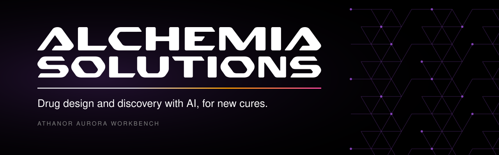
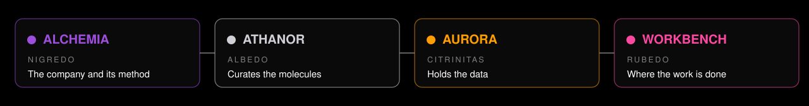
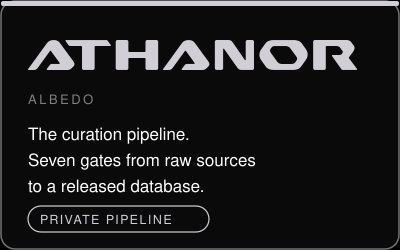
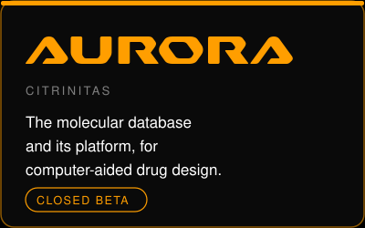
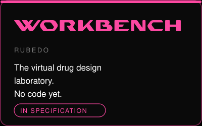

 

## Who we are

**Alchemia Solutions** is the drug design and discovery brand of **Alchemia LTDA**, a Brazilian company based in
Barretos, São Paulo. We build tools that use AI to bring new cures closer: a curation pipeline, an open molecular
database and, next, a virtual laboratory. We work in Brazil and abroad.

Our work is named after the stages of the alchemical **Great Work**. Each product is one stage of the same
transformation, from raw matter to a finished remedy.

## Our products

<table>
<tr>
<td width="33%" valign="top"></td>
<td width="33%" valign="top"></td>
<td width="33%" valign="top"></td>
</tr>
</table>

| Product | What it is | Where to read about it |
|---|---|---|
| **ATHANOR** | The private curation pipeline. Seven gates take public compound collections from raw records to a validated, documented database. The code is private; the method is described in public | [The seven gates](https://github.com/alchemia-solutions/aurora/blob/main/docs/PIPELINE.md) |
| **AURORA** | A molecular database for computer-aided drug design. Every compound has a curated structure, an approved 3D conformer, a docking file, computed features and its provenance. Two packages, each under its own licence: CC BY-SA 4.0 and CC BY-NC 4.0 | [Repository](https://github.com/alchemia-solutions/aurora) · [Platform](https://aurora.alchemia.solutions) |
| **WORKBENCH** | A virtual laboratory for drug design, by subscription. It is in specification and has no code yet | Not available |

## Featured repository

| Repository | What it holds |
|---|---|
| [**aurora**](https://github.com/alchemia-solutions/aurora) | The public description of AURORA: the data model, the sources and their terms, the seven ATHANOR gates, the API and examples that read it |

## What guides our work

- **Completeness is not correctness.** Every stage of our pipeline has a chemical correctness check, not only a
  count. A pipeline that reports near-total coverage can still carry wrong stereochemistry, and nothing in the
  report will say so.
- **The pipeline is private, the data is open.** The data goes out under Creative Commons licences. The furnace
  stays ours.
- **Provenance and licence on every record.** Each source keeps its own terms, and each compound says where it
  came from.
- **Honest limits.** We say what is not measured, not published or not decided, and we date every figure we
  print.

## Work with us

- **Test AURORA.** The platform is a closed beta for approved accounts. Write to
  [contact@alchemia.solutions](mailto:contact@alchemia.solutions) to ask for access.
- **Register a study or suggest a database.** Use [Collaborate](https://aurora.alchemia.solutions/collaborate) on
  the platform.
- **Contribute.** Issues and pull requests are welcome in our public repositories, for documentation, examples
  and corrections. Each one has a Contributing guide and a Code of Conduct.
- **Partnerships and sponsorship.** [contact@alchemia.solutions](mailto:contact@alchemia.solutions).

## Cite

If you use AURORA, cite it by name and publisher, the release you used and the date you accessed it, and cite
the upstream sources you used too. Each repository carries a `CITATION.cff` with the form to use.

Alchemia Solutions is a brand of Alchemia LTDA. The ALCHEMIA, ATHANOR, AURORA and WORKBENCH names and symbols are trademarks of Alchemia LTDA.

